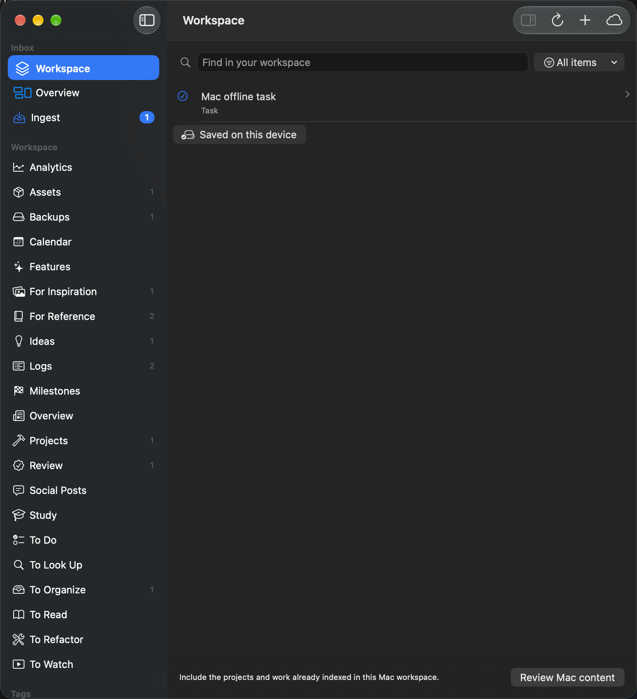

# Better Workspace

A native workspace for Mac, iPhone and iPad that brings projects, tasks and ideas closer to your next useful step.



[Download advanced Mac 1.0.5](https://github.com/ZSturman/Better-Workspace-Public/releases/tag/v1.0.5) · [Try the browser demo](https://zacharysturman.com/better-workspace/demo) · [Portfolio](https://zacharysturman.com/projects/better-workspace) · [Getting started](docs/GETTING_STARTED.md)

## Menu bar capture

Quick ingest keeps its draft and destination while choosing files. Finder-copied
movies stay as original attachments beside an idea note. Removing a file keeps the
text; errors wrap in full. Completed idea saves request a macOS notification.
Allow banners in System Settings. Save before quitting: drafts remain in memory.

## What it does

- Organize projects, tasks, ideas and documents in a native personal workspace.
- Save portable records offline; private iCloud synchronization in the development update is still undergoing acceptance.
- Use the advanced Mac edition to browse existing folders and portable Markdown plans.
- Prioritize work, capture thoughts and links, review progress and work history.
- Optionally connect mobile folder browsing, Notion and selected agent tools.

Built for people with creative, personal and technical projects who want to keep their files and make the next step easier to find.

## Install

Download **BetterWorkspace-1.0.5-57-mac.zip** from [Releases](https://github.com/ZSturman/Better-Workspace-Public/releases/tag/v1.0.5). Expand the ZIP, drag **Better Workspace.app** to Applications, and open it. Select your folders in Settings → General and enable the included background service in Settings → Services when needed. No separate Python installation is required.

The advanced download supports macOS 14.4+ on Apple silicon and Intel. It is Developer ID signed, notarized and stapled. [Installation and first-use guide](docs/GETTING_STARTED.md).

The development iPhone/iPad app (iOS/iPadOS 17+) now opens a local portable workspace without requiring a Mac. The shared editor supports projects, tasks, features, milestones, goals, ideas, folders and notes. Existing notebook records are imported additively. Connecting devices presents a recoverable merge preview and preserves concurrent edits for review. The Phase 1 core milestone is reached and Phase 2 macOS features are implemented. This update has **not passed its release gate**: isolated Production cloud checks and normal three-device linking/content/conflict checks have passed, while full filesystem, upgrade, installed-widget/integration and physical network-reconnect acceptance remain incomplete. Published downloads and screenshots from earlier releases do not demonstrate this new transport. The advanced Mac remains a direct download; the personal-only Mac Store edition is retired.

In development builds, open **Devices & recovery** on each device and connect using
the same private iCloud account. Merge choices appear near the top, and approved
peers remain under **Connected workspaces**. If the list is empty, keep the other app
open and synchronize both devices. On Mac, **Review Mac content** separately previews
existing indexed projects and notes; pairing alone does not download development trees.
Work text stays available when a linked project/folder is unavailable. The app flags
the location for review and preserves the original Mac link during body-only saves.

In macOS development source, **Workspace Setup** is available in the toolbar and
Settings → General. Preview an optional starter structure or keep custom folders.
Only checked missing categories are created; existing contents are preserved. A root
change takes effect on the next launch. Contextual tips explain Area Settings and
underscore grouping. Root apps now show details, native launch and Shortcuts actions. Webpage shortcuts and linked notes open inline with navigation/reload/error handling; other root files retain default-app actions.

## Demo

[Explore the demonstration](https://zacharysturman.com/better-workspace/demo) without an account or installation. It combines real application screenshots with fictional, browser-only interactions. The retained sample tooling uses fictional, memory-only data. The current shared-editor screenshots also use isolated fictional records.

## Build from source

Requirements: macOS, Xcode with current Apple SDKs, XcodeGen. The advanced service runtime preparation requires Python 3.12+ and downloads checksum-verified vendor runtimes. Configure your own signing team, bundle identifiers, app groups and iCloud capabilities for device/distribution builds.

```sh
xcodegen generate
open BetterWorkspace.xcodeproj
```

Select **BetterWorkspaceMobile** with an iPhone/iPad destination, or **BetterWorkspace** for advanced Mac. Before building the advanced edition:

```sh
python3 Tools/prepare_python_runtime.py
```

Vendor runtimes and generated Xcode projects stay outside Git. The signed public binary uses the publisher's capabilities; source builds need your own provisioning. Notion and external agent tools are optional.

## Architecture

| Path | Role |
| --- | --- |
| Sources/Core | Shared filesystem, captures, private metadata and models |
| Sources/Mac | Advanced Mac UI and service integration |
| Sources/StoreMac, Sources/SharedUI | Retained sandboxed test entry and shared portable editor |
| Sources/Mobile | Independent iPhone/iPad home and optional Mac tools |
| BackgroundService | Bundled Python service, private SQLite and optional integrations |
| Tests | Swift Core and isolated UI fixtures |
| Tools | Runtime preparation, archive and package verification |

Organized folders remain user-owned. Private metadata is separate from file content. Remote integration changes require explicit reviewed actions. The portable journal uses persistent UUIDs and immutable revision ancestry; filenames and timestamps do not decide identity or conflict winners. Earlier SwiftData records remain an additive upgrade source. The folder index stays separate from private revision/adapter metadata; approved adapters connect selected records through the existing Mac editor.

## Development and verification

Prefer a targeted suite using your own disposable fixtures:

```sh
xcodebuild -project BetterWorkspace.xcodeproj -scheme BetterWorkspace \
  -destination 'platform=macOS,arch=arm64' test \
  -only-testing:BetterWorkspaceCoreTests/TagStoreTests
```

See [BackgroundService/README.md](BackgroundService/README.md) for its Python development setup. Do not run opt-in personal-workspace diagnostics against someone else's files. The public release's [notes](docs/RELEASE_NOTES_1.0.md) describe acceptance and remaining limits. Separate-user advanced installer/login acceptance and wider widget configuration checks remain follow-ups.

## Support and contributing

[Setup & support](https://zacharysturman.com/better-workspace/support) · [Privacy](https://zacharysturman.com/better-workspace/privacy)

Bug reports and focused contributions are welcome. Include version, device/OS and reproducible steps using fictional data. Never include credentials or personal workspace contents. This repository is a clean public release snapshot; private development history, device identifiers and personal QA evidence are excluded.

MIT License © 2026 Zachary Sturman. Third-party runtimes and dependencies retain their own licenses.
