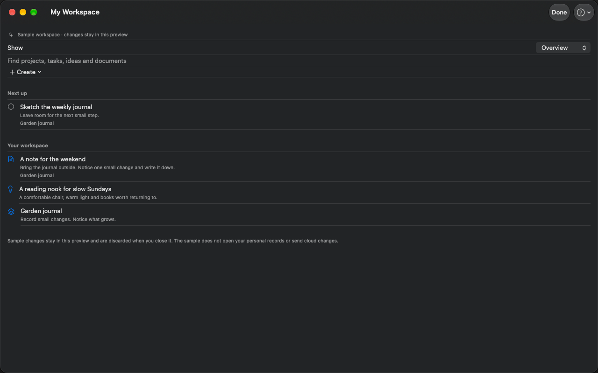

# Better Workspace

A native workspace for Mac, iPhone and iPad that brings projects, tasks and ideas closer to your next useful step.



[Download advanced Mac 1.0](https://github.com/ZSturman/Better-Workspace-Public/releases/tag/v1.0) · [Try the browser demo](https://zacharysturman.com/better-workspace/demo) · [Portfolio](https://zacharysturman.com/projects/better-workspace) · [Getting started](docs/GETTING_STARTED.md)

## What it does

- Organize projects, tasks, ideas and documents in a native personal workspace.
- Save offline and synchronize personal records through private iCloud when available.
- Use the advanced Mac edition to browse existing folders and portable Markdown plans.
- Prioritize work, capture thoughts and links, review progress and work history.
- Optionally connect mobile folder browsing, Notion and selected agent tools.

Built for people with creative, personal and technical projects who want to keep their files and make the next step easier to find.

## Install

Download **BetterWorkspace-1.0-8-mac.zip** from [Releases](https://github.com/ZSturman/Better-Workspace-Public/releases/tag/v1.0). Expand the ZIP, drag **Better Workspace.app** to Applications, and open it. Select your folders in Settings → General and enable the included background service in Settings → Services when needed. No separate Python installation is required.

The advanced download supports macOS 14.4+ on Apple silicon and Intel. It is Developer ID signed, notarized and stapled. [Installation and first-use guide](docs/GETTING_STARTED.md).

The separate sandboxed Store app supports native Mac, iPhone and iPad (macOS 14.4+, iOS/iPadOS 17+). It works independently with personal records and optional private iCloud sync. Both native Mac and iPhone/iPad 1.0 (Build 8) were submitted October 16 and are Waiting for Review, with automatic release after approval. See the [portfolio](https://zacharysturman.com/better-workspace) for public installation availability. The advanced Mac edition adds real-folder/service/automation features. Connected mobile folder features require the advanced Mac; personal workspace features do not.

## Demo

[Explore the demonstration](https://zacharysturman.com/better-workspace/demo) without an account or installation. It combines real application screenshots with fictional, browser-only interactions. The native Store app also includes an editable, memory-only private sample.

## Build from source

Requirements: macOS, Xcode with current Apple SDKs, XcodeGen. The advanced service runtime preparation requires Python 3.12+ and downloads checksum-verified vendor runtimes. Configure your own signing team, bundle identifiers, app groups and iCloud capabilities for device/distribution builds.

```sh
xcodegen generate
open BetterWorkspace.xcodeproj
```

Select **BetterWorkspaceApp** for the native Store experience, or **BetterWorkspace** for advanced Mac. Before building the advanced edition:

```sh
python3 Tools/prepare_python_runtime.py
```

Vendor runtimes and generated Xcode projects stay outside Git. The signed public binary uses the publisher's capabilities; source builds need your own provisioning. Notion and external agent tools are optional.

## Architecture

| Path | Role |
| --- | --- |
| Sources/Core | Shared filesystem, captures, private metadata and models |
| Sources/Mac | Advanced Mac UI and service integration |
| Sources/StoreMac, Sources/SharedUI | Sandboxed Mac entry and shared personal workspace |
| Sources/Mobile | Connected iPhone/iPad UI |
| BackgroundService | Bundled Python service, private SQLite and optional integrations |
| Tests | Swift Core and isolated UI fixtures |
| Tools | Runtime preparation, archive and package verification |

Organized folders remain user-owned. Private metadata is separate from file content. Remote integration changes require explicit reviewed actions. Personal SwiftData/iCloud records are independent of the connected-folder index.

## Development and verification

Prefer a targeted suite using your own disposable fixtures:

```sh
xcodebuild -project BetterWorkspace.xcodeproj -scheme BetterWorkspace \
  -destination 'platform=macOS,arch=arm64' test \
  -only-testing:BetterWorkspaceCoreTests/TagStoreTests
```

See [BackgroundService/README.md](BackgroundService/README.md) for its Python development setup. Do not run opt-in personal-workspace diagnostics against someone else's files. The public release's [notes](docs/RELEASE_NOTES_1.0.md) describe acceptance and remaining limits. Separate-user advanced installer/login acceptance and wider widget configuration checks remain follow-ups.

## Support and contributing

[Setup & support](https://zacharysturman.com/better-workspace/support) · [Privacy](https://zacharysturman.com/better-workspace/privacy)

Bug reports and focused contributions are welcome. Include version, device/OS and reproducible steps using fictional data. Never include credentials or personal workspace contents. This repository is a clean public release snapshot; private development history, device identifiers and personal QA evidence are excluded.

MIT License © 2026 Zachary Sturman. Third-party runtimes and dependencies retain their own licenses.
